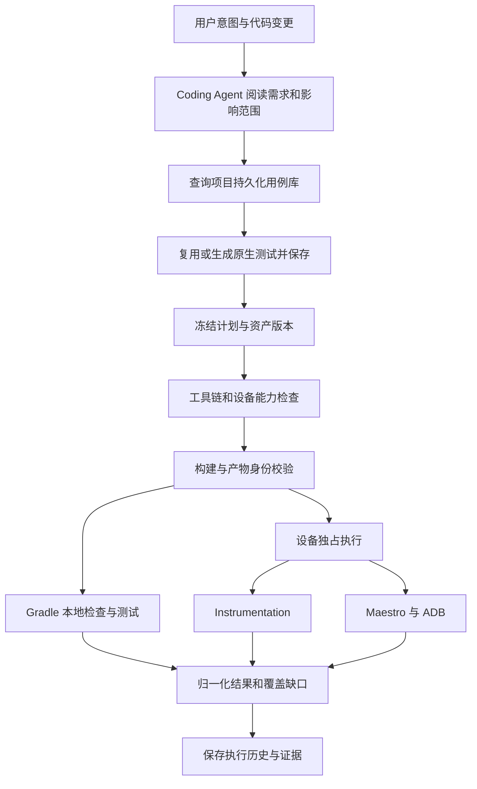

# 02 总体架构与执行流程

## 1. 三个边界

1. **工具仓库**：通用 CLI、元数据 schema、适配器、模板、工具测试和公开合成样例。
2. **被测项目/专用测试仓库**：项目配置、需求契约、用例目录、原生测试与合成业务数据。
3. **运行目录**：不可变计划、源码与资产指纹、产物清单、日志、报告、证据；默认不提交 Git，使用持久磁盘或 CI artifact 存储。

共享模板不等于共享业务用例。两个 App 可以复用“权限拒绝后不崩溃”模板，但各自的权限、页面、预期与测试 ID 独立保存。

## 2. 模块职责

| 模块 | 输入/输出 | 不承担的职责 |
|---|---|---|
| Project loader | 读取配置、解析相对路径、验证依赖和能力 | 不猜测业务阈值 |
| Catalog | 搜索、校验、版本引用、测试资产依赖索引 | 不运行 LLM，不改变断言 |
| Planner | 将 Agent 选择解析为固定任务/用例/设备要求清单 | 不声称静态调用图完整 |
| Process runner | 参数数组启动、超时、取消、进程树清理、日志 | 不执行任意自然语言 shell |
| Gradle adapter | 运行配置任务、解析 Lint/JUnit/设备结果 | 不强制 Gradle/JUnit 升级 |
| Maestro adapter | 运行原生 flow、收集结构化报告与证据 | 不重新实现 UI 操作 |
| Device adapter | 指定 serial、能力检查、安装、取证、租约 | 不假设设备 root 或所有 shell 功能可用 |
| Reporter | 关联 case 与本次结果、JSON/Markdown/JUnit 汇总 | 不以截图或退出码推断全部正确 |

所有外部执行都经同一个 process runner，保留 argv、工作目录、开始/结束时间、退出信息；环境值只记录允许公开的键与脱敏摘要。

## 3. 执行协议

1. 读取显式指定的项目配置；确认源码模式或 APK-only 模式。
2. 用例先保存到项目库，再冻结计划。记录选择、排除、缺口和来源。
3. doctor 检查环境。缺设备不妨碍已可执行的本地测试，但本次设备部分必须 BLOCKED。
4. 按配置 DAG 构建。复制 AAR、生成代码、宿主构建、test APK 等均作为显式节点；下游只在前置成功后运行。
5. 记录源码快照、构建产物哈希和工具版本。执行期间变更相关输入时中止或创建新运行，不能混用两次构建证据。
6. 获取设备租约，核对 API/ABI、包名和配置。安装明确的产物；签名冲突报告原因，不自动卸载造成数据丢失。
7. 依计划执行测试，收集本次生成的报告；拒绝读取上一次遗留报告冒充本次结果。
8. finally 清理：释放测试 gate、退出受控测试进程、恢复已修改状态、停止 logcat、释放租约。清理失败记录为环境污染。
9. 原子落盘结果；运行进程意外退出时，下次发现未完成记录标为 ERROR，不推断通过。

首期单设备串行执行。Maestro、独立 UI Automator、instrumentation 对设备 UI 的控制互斥；宿主侧本地测试并行要遵循 Gradle/构建输出隔离。

## 4. 观察与断言

UI 可见结果可以直接由 Maestro 验证。内部状态有三种来源：已有业务接口、测试服务端证据、仅存在于 debug/test 构建的探针。探针由项目按需提供，通用工具不向任意 APK 注入探针。

线程测试可观察 task ID、worker ID、开始/完成、替换和退出事件；网络测试可观察关联请求、响应和幂等键。事件必须绑定 run/case，避免串用上次状态。观测不足明确列 gap。

测试进程的正常/异常结束不等于测试通过。若必需断言依赖设备事件但事件丢失，应报 ERROR 或 BLOCKED，而非 PASS。按项目契约区分任务失败和产品崩溃。

## 5. 结果模型

case outcome：`PASS / FAIL / BLOCKED / ERROR / SKIPPED`。运行中另有 `PENDING / RUNNING / CANCELLED` 状态；取消后整体不能 PASS。`FLAKY` 是跨尝试的可靠性标记，保留所有尝试结果，不替换首次失败。

- FAIL：预期与实际不符。
- ERROR：工具、解析、连接、进程或报告异常。
- BLOCKED：执行前缺必要能力、数据或明确契约。
- SKIPPED：计划定义为不适用或主动排除，必须有原因。
- PASS：本次选定的所有必需断言实际执行并满足。

必需用例出现 FAIL/ERROR/BLOCKED/SKIPPED/CANCELLED，或被隔离排除，门禁不通过。零用例的计划不能成功。仅运行 fast profile 的通过，不代表 full profile 通过。

静态检查无“测试条数”时，以实际生成的完整工具报告、约定 issue policy 与退出结果判断；本地/设备/UI 测试还需验证预期 case 被发现且实际执行。

## 6. 复现和数据隔离

每次运行记录：配置版本、工具版本、源码 commit 与 dirty 指纹、用例 revision、资产闭包哈希、APK/test APK 哈希、variant、API/ABI、匿名化设备引用、seed、计划、结果和证据索引。

哈希只能识别输入，不能单独恢复文件。未提交测试资产保存到本地不可变快照；源码重建需要原 commit 与受控 dirty patch/相关未跟踪文件，无法保存时明确“不可完整重建”。APK 可按策略保留并校验哈希。

配置中的测试端点、密钥环境引用、设备策略归项目所有。公共仓库不保存这些运行快照。证据保留期可配置；过期删除需留下索引标记，失败证据支持固定保留。
